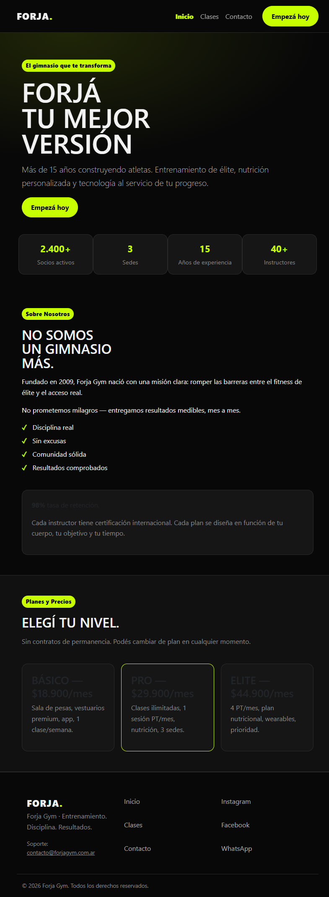
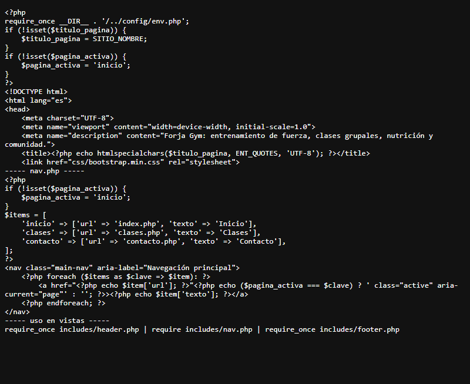
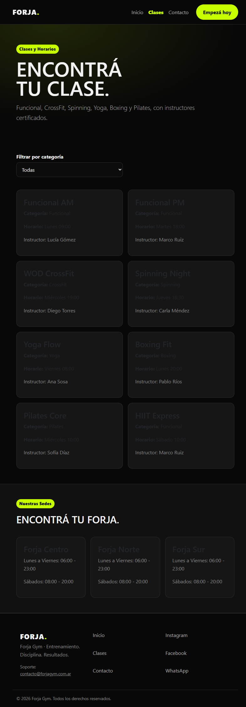
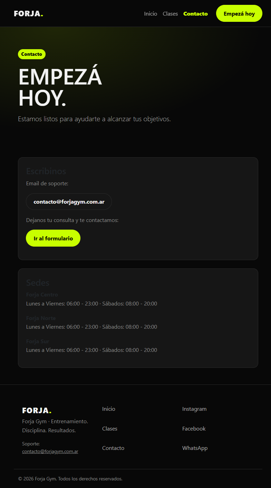
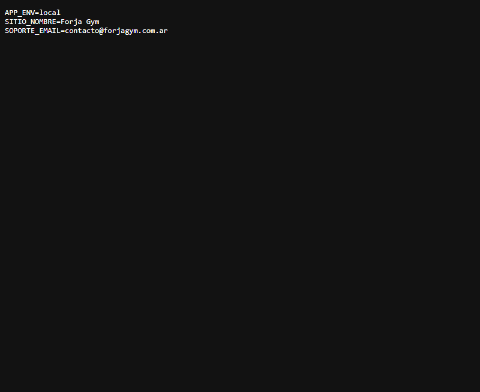

# Trabajo Práctico 4: Migración a PHP, SSI y SSR

Volver al [índice](../README.md)

## Contenido de esta carpeta

| Carpeta | Contenido |
|---|---|
| [`capturas/`](capturas/) | 5 capturas de evidencia que pide la consigna |

## A. Migración y servidor local

| Requisito | Estado | Evidencia |
|---|---|---|
| Pantallas renombradas a `.php` | ✅ | [`index.php`](../index.php), [`clases.php`](../clases.php), [`contacto.php`](../contacto.php) |
| Ejecución en servidor local | ✅ |  |

## B. Modularización (SSI)

| Requisito | Estado | Evidencia |
|---|---|---|
| `header.php` (`<head>`, metadatos, CSS) | ✅ | [`includes/header.php`](../includes/header.php) |
| `nav.php` | ✅ | [`includes/nav.php`](../includes/nav.php) |
| `footer.php` (pie y scripts JS) | ✅ | [`includes/footer.php`](../includes/footer.php) |
| Vistas con `require` / `require_once` | ✅ | Las tres vistas |
| Captura del código modular | ✅ |  |

## C. SSR y variables dinámicas

| Requisito | Estado | Evidencia |
|---|---|---|
| `<title>` dinámico con `$titulo_pagina` | ✅ | Inicio, Clases y Contacto con "- Forja Gym" |
| Ítem activo del menú | ✅ | `$pagina_activa` en `nav.php`, con `class="active"` y `aria-current` |
| Captura de navegación | ✅ |   |

## D. Variables de entorno

| Requisito | Estado | Evidencia |
|---|---|---|
| `.env` con nombre, email y `APP_ENV=local` | ✅ | [`config/env.php`](../config/env.php) lo carga |
| `.env` en `.gitignore` | ✅ | Verificado: `.env` no está versionado |
| `.env.example` en el repositorio | ✅ | [`.env.example`](../.env.example)  |

## Entrega y Git

| Requisito | Estado | Evidencia |
|---|---|---|
| README con las 5 secciones | ✅ | [README raíz, TP4](../README.md#trabajo-práctico-n-4--migración-a-php-ssi-y-ssr-unidad-4) |
| Rama `feature/migracion-php-ssi` integrada por PR | ✅ | PR #5 |
| Commits atómicos y descriptivos | ✅ | `feat: extrae plantillas ssi header nav footer…`, `feat: migra vistas html a php con titulo dinamico y menu activo`, `feat: agrega variables de entorno…` |
| Entrega en Classroom | ⏳ | Solo la URL: https://github.com/IsaiasDc2/PW_GYM |

## Extras

- PR #6 (`feature/bootstrap-responsive`): Bootstrap 5.3 autohospedado.
- PR #7 (`fix/cliente-sin-texto-interno`): ajustes de textos y filtro de clases.
